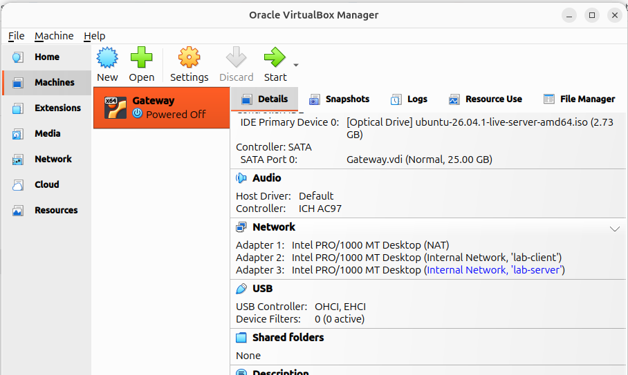
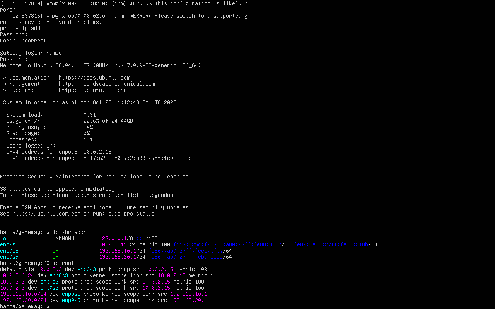
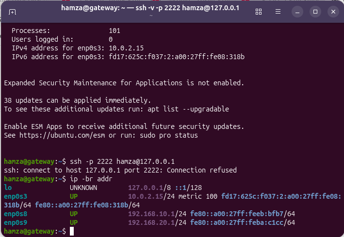

# Virtual Network Lab — Architecture

## Status

**Implemented and tested:** three-VM network, IPv4 routing, outbound NAT,
and persistence of IP forwarding and firewall rules after reboot.

**Not yet completed:** restrictive firewall policies, dedicated DHCP/DNS
services, web-server deployment validation, and comprehensive security tests.

## Topology

```text
                    Internet
                       |
                VirtualBox NAT
                       |
                Gateway: enp0s3
                   10.0.2.15
                       |
                 +-----------+
                 |  GATEWAY  |
                 | IPv4      |
                 | forwarding|
                 | NAT       |
                 +-----------+
                  /         \
       lab-client             lab-server
          |                       |
    enp0s8                  enp0s9
 192.168.10.1             192.168.20.1
          |                       |
       CLIENT                  SERVER
   192.168.10.10           192.168.20.10
```

## Virtual machines

| VM | Interface | Address | VirtualBox network |
|---|---|---|---|
| Gateway | enp0s3 | 10.0.2.15/24 | NAT |
| Gateway | enp0s8 | 192.168.10.1/24 | Internal: lab-client |
| Gateway | enp0s9 | 192.168.20.1/24 | Internal: lab-server |
| Client | configured interface | 192.168.10.10/24 | Internal: lab-client |
| Server | configured interface | 192.168.20.10/24 | Internal: lab-server |

The gateway's WAN address is assigned by VirtualBox NAT. The client and
server use the gateway interface in their respective subnet as their default
gateway.

## Implemented networking

- IPv4 forwarding enabled through `/etc/sysctl.d/99-devops-lab.conf`.
- Outbound source NAT (MASQUERADE) on `enp0s3`.
- Forwarding rules for outbound traffic from the client and server networks.
- Return traffic rules using connection tracking.
- Persistent iptables rules managed by `iptables-persistent`.
- SSH administration from the host through VirtualBox NAT port forwarding
  on host port `2222` to guest port `22`.

## Security limitations

The current saved iptables configuration uses ACCEPT policies for INPUT,
FORWARD, and OUTPUT. Therefore, the lab does **not yet implement a
default-deny firewall**. The current forwarding policy is permissive beyond
the explicitly listed rules because the FORWARD chain policy is ACCEPT.

Do not describe the gateway as fully hardened. Default-deny policies,
least-privilege rules, logging, and positive and negative security tests
remain future work.

## Evidence

- VirtualBox network configuration:
  
- Gateway routing table:
  
- SSH from the host:
  
- NAT and forwarding after reboot:
  
