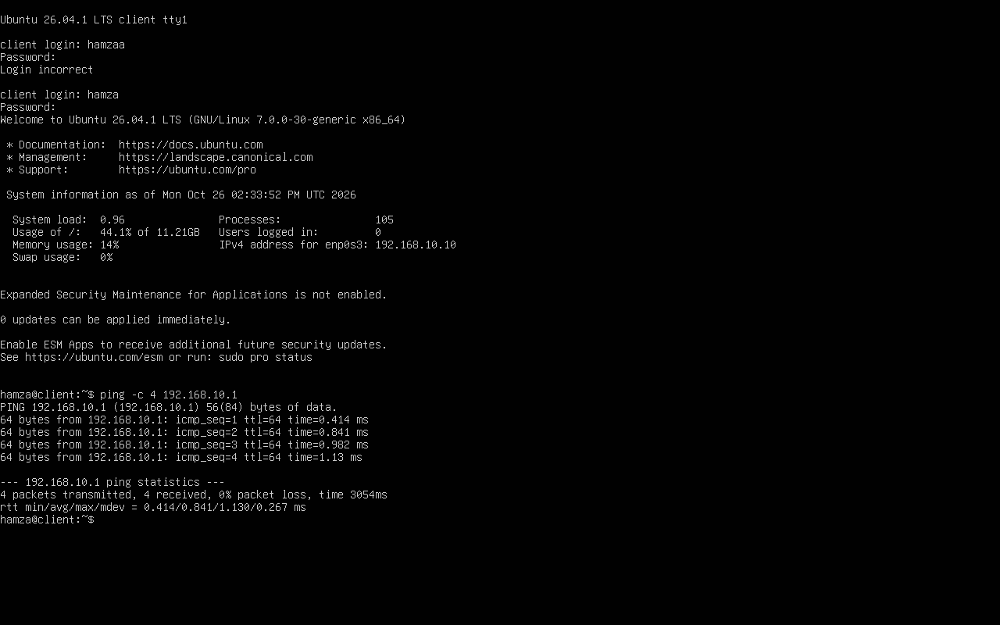
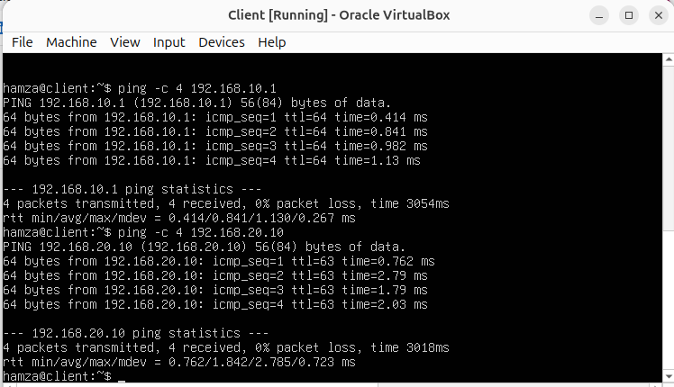
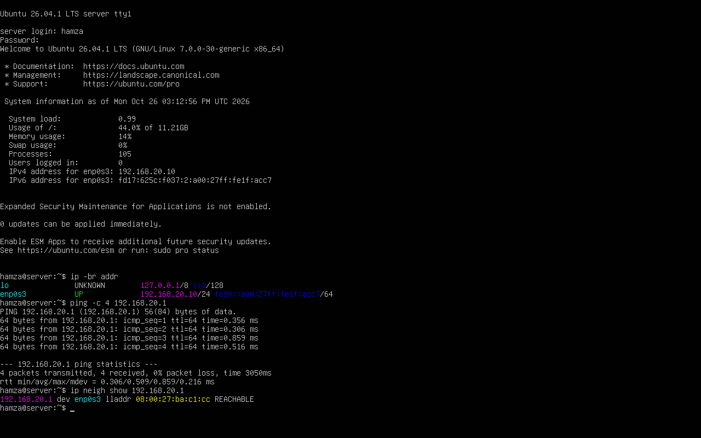
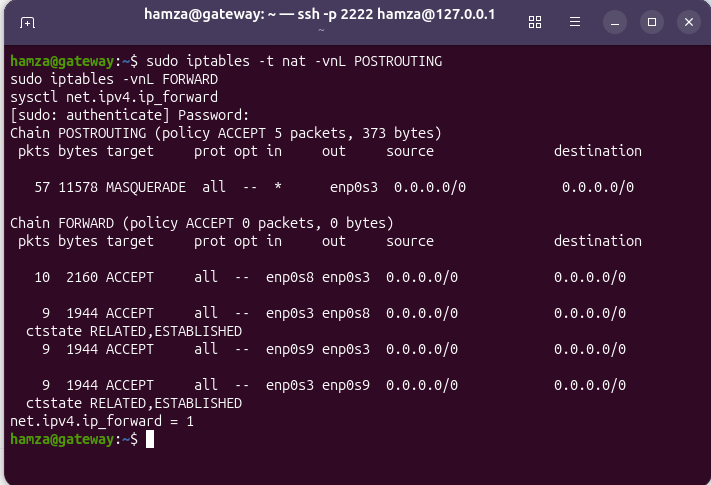

# Virtual Network Lab — Validation Report

## Scope

This report records the networking checks performed during implementation.
It distinguishes observed results from features that have not yet been
validated.

## Test results

| Test | Expected result | Observed result | Status |
|---|---|---|---|
| Client to gateway (`192.168.10.1`) | Gateway responds | Ping succeeded | PASS |
| Server to gateway (`192.168.20.1`) | Gateway responds | Ping succeeded | PASS |
| Client to server (`192.168.20.10`) | Routed connectivity | Ping succeeded during testing | PASS |
| Gateway to public IP (`1.1.1.1`) | Outbound connectivity | Ping succeeded | PASS |
| Client and server to public IP | Outbound NAT works | Ping succeeded | PASS |
| DNS lookup (`ubuntu.com`) | Name resolves | `getent hosts` returned an address | PASS |
| IPv4 forwarding after reboot | Value remains `1` | Verified with `sysctl` | PASS |
| NAT and forwarding rules after reboot | Rules are restored | Verified with iptables and counters | PASS |
| SSH from host to gateway | SSH connection works | Connected through host port `2222` | PASS |

These results describe the tests actually performed. They do not establish
that all firewall security requirements have been met.

## Evidence

### Client connectivity

### Server connectivity

### Persistence after reboot

## Known limitations and next tests

- Change firewall policies to default-deny only after defining the required
  traffic flows and a recovery procedure.
- Test allowed and blocked traffic between LAN, DMZ, and WAN.
- Verify firewall counters and rate-limited logging for denied traffic.
- Validate SSH key-based access and restrict administrative exposure.
- Deploy and test the web server and HTTP access rules.
- Configure dedicated DHCP/DNS services if they remain in scope.
- Capture command output and timestamps for reproducible test evidence.

## Reproducibility

For future test runs, record the date, VM, command, expected result,
observed result, and evidence filename. Do not mark a test as passed until
it has been rerun and its result recorded.
